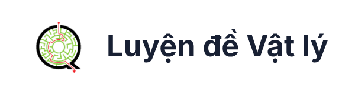
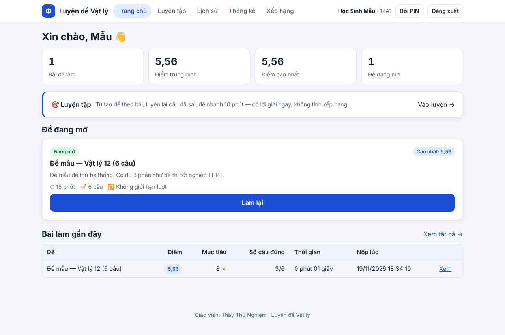
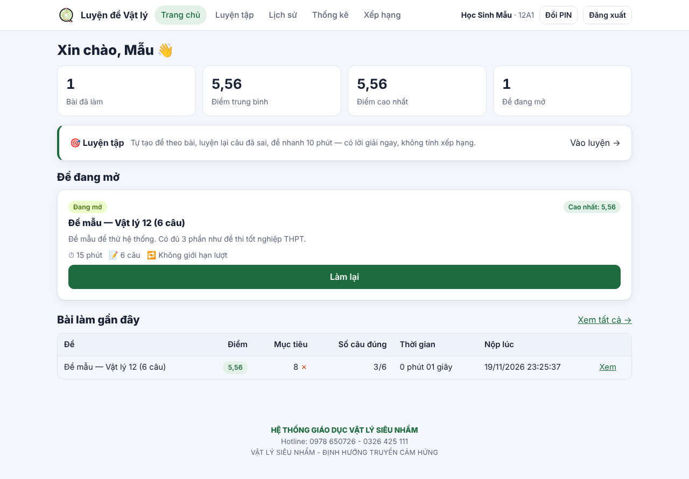

# Báo cáo Pha 5 — Màu xanh #1D6B3E và logo VLSN (giữ bố cục)

## Tóm tắt cho giáo viên (bản của người làm)
- Trang web giữ nguyên cách sắp xếp. Các khối đo được không lệch điểm ảnh nào so với bản đang chạy.
- Màu xanh dương đổi thành xanh lá đậm **#1D6B3E**. Màu "đúng" đổi sang xanh nõn chuối, nên không lẫn với màu chính.
- Chữ "Φ" ở góc trên trái đổi thành **logo tạm** (logo mê cung chữ Q lấy từ file Word mẫu). Logo này cũng là biểu tượng trên tab trình duyệt. Đây **chưa phải** logo chuẩn vatly.ai.
- Cuối trang có dòng "HỆ THỐNG GIÁO DỤC VẬT LÝ SIÊU NHẨM", hotline và slogan, ở cả trang học sinh lẫn trang quản trị. Tên giáo viên không còn hiện.
- Thầy không phải dán lại Code.gs. Thầy chỉ cần trả lời câu hỏi về logo (cuối báo cáo). Đổi logo về sau = thay đúng một file ảnh.

---

## Người làm

### Logo tạm
- **Nguồn:** ảnh logo trong khung đầu đề của file Word mẫu `MAU_CHUAN_WORD_VLSN.docx` (thư mục `word/media/`). Điều phối viên trích sẵn thành PNG 339×339, nền trong suốt. File .docx không đưa vào repo.
- **Đây là logo TẠM** (logo mê cung chữ Q). Quyết định 18/11 đã gạch logo này khỏi phương án chuẩn. Web dùng tạm cho tới khi có logo vatly.ai.
- **Cách cắt:** bỏ phần chữ "VẬT LÝ SIÊU NHẨM" (chỉ giữ hàng 0–275 của ảnh gốc; chữ nằm ở hàng 282–310). Lấy khung bao phần không trong suốt (x 64–270, y 30–268). Đặt giữa một ô vuông trong suốt, chừa lề 4 px. Thu về 96×96 (Lanczos, Python PIL).
- **Kết quả:** `assets/img/logo-vlsn.png`, PNG RGBA 96×96, 15,9 KB, 4 góc trong suốt.
- Hai trang có chú thích HTML `<!-- Logo TẠM (mê cung chữ Q từ file Word mẫu). Logo chuẩn (vatly.ai): thay file assets/img/logo-vlsn.png, giữ tên, không sửa code. -->`.
- Ảnh phóng to đầu trang có logo tạm: `anh/pha-5/19-logo-tam-dau-trang.png`.

### Bảng tự kiểm TC
Lệnh:
- `node tests/pha5.test.js` → 9/9 đạt (thêm `BANG=1` để in bảng tương phản).
- `NODE_PATH=$(npm root -g) LIBS_DIR=… node tests/pha5.e2e.js all` → máy chủ mới và `SERVER_COMPAT=1.0.0`, đạt hết.
- Số đo "trước": `git worktree add <nháp>/wt-main origin/main` rồi `TRUOC_ROOT=<nháp>/wt-main node tests/pha5.e2e.js truoc`. Đã xóa worktree tạm sau khi đo.

| Mã | Mô tả | Kết quả | Bằng chứng |
|---|---|---|---|
| TC-5.1 | Màu cũ hết; `--primary: #1D6B3E`; mã màu còn lại thuộc danh sách cho phép | ĐẠT | `pha5.test.js`: 0 kết quả cho 9 chuỗi cũ trong `index.html`, `admin.html`, `style.css`, `assets/js/*.js`; danh sách cho phép = mã màu của `main` trừ 8 mã cũ + 10 mã mới của bảng ánh xạ |
| TC-5.2 | Tương phản ≥ 4,5:1; viền focus ≥ 3:1 | ĐẠT | 22 cặp, thấp nhất 4,99 (`--good` trên `--surface-2`). Xem bảng dưới |
| TC-5.3 | ΔE76 ≥ 25; hai khối tối giống hệt | ĐẠT | Thấp nhất 27,0 (`--primary`/`--good` sáng). Hai khối tối cùng giá trị mọi biến |
| TC-5.4 | File logo tạm: PNG 96×96, ≤ 20 KB, alpha, 4 góc trong suốt, đã cắt chữ; chú thích "Logo TẠM" | ĐẠT | 15 911 byte; đọc pixel bằng `zlib` (không cần thư viện). "Đã cắt chữ": ở 1/5 dưới cùng không hàng nào phủ quá 60% bề rộng (logo gốc chưa cắt: 76% → test báo lỗi, đã thử) |
| TC-5.5 | Logo ở 4 vị trí, một file | ĐẠT | e2e: `img.brand-logo` 34×34, `object-fit: contain`, nền `rgb(255, 255, 255)` ở cả sáng và tối, `naturalWidth = 96`; đăng nhập, trang chủ, tổng quan quản trị; favicon hai trang HTTP 200. Thử thay bằng PNG ngang 300×100 (chỉ trong trình duyệt thử): khung vẫn 34×34, bố cục trang chủ không đổi (ảnh 20). Không còn `Φ`; không đường dẫn ảnh nào khác |
| TC-5.6 | 2 thẻ `theme-color` | ĐẠT | `pha5.test.js` |
| TC-5.7 | Chân trang 3 chuỗi; không tên giáo viên | ĐẠT | Đặt `TEN_GIAO_VIEN` = "Thầy Thử Nghiệm" bằng `adminSaveSettings` trước khi tải trang. Trang chủ học sinh và tổng quan quản trị có đủ 3 chuỗi; "Thầy Thử Nghiệm" và "Giáo viên:" không có trong đầu trang và chân trang. Màn làm bài ẩn chân trang. Cả hai máy chủ |
| TC-5.8 | Không đổi bố cục | ĐẠT | So `bo-cuc-truoc.json` (main) với `bo-cuc-sau.json`: 6 màn × 2 khổ, mọi khối lệch **0 px**. Khổ 390: `#userBox` không cùng hàng `.brand` ở cả main lẫn nhánh (giống nhau). Xem ghi chú phông |
| TC-5.9 | Ảnh chụp | ĐẠT | 12 ảnh sáng + 6 ảnh tối + 2 ảnh "trước" + 1 ảnh phóng to logo tạm (+ 1 ảnh thử logo ngang). Danh sách dưới |
| TC-5.10 | Biểu đồ đọc biến CSS | ĐẠT | `chTimeline` viền `#1d6b3e` = `--primary`; `chBins` = `--primary`; `chQ` dùng 3 màu `#4a7311`, `#c2410c`, `#1d6b3e`. Cả hai máy chủ |
| TC-5.11 | Không lỗi JS | ĐẠT | Không `pageerror`, không `console.error` ở mọi màn, cả hai máy chủ và cả bản main. Lỗi tải Google Fonts/CDN bị bỏ qua (mạng chặn; KaTeX, Chart.js lấy từ `LIBS_DIR`) |
| TC-5.12 | Không cuộn ngang | ĐẠT | `scrollWidth ≤ innerWidth` ở 6 màn + Thống kê, khổ 390 và 1280, sáng và tối |
| TC-5.13 | Test cũ đạt | ĐẠT (trừ K-1 có sẵn trên main) | Xem mục "Test cũ" |
| TC-5.14 | Máy chủ không đổi | ĐẠT | `git diff origin/main -- apps-script/` rỗng (trong `pha5.test.js`) |
| TC-5.15 | Lighthouse ≥ 90 (khuyến nghị) | CHƯA ĐO | Không có Lighthouse trong môi trường (mạng chặn tải gói). Để kiểm thử viên/Pha 6 |

### Bảng tương phản (tính từ `style.css` bằng `tests/pha5.test.js`, công thức WCAG 2.1)
| Cặp | Màu | Tỉ lệ |
|---|---|---|
| Chữ trắng trên `--primary` (nút chính, sáng) | #ffffff / #1d6b3e | 6,51 |
| Chữ trắng trên `--primary-hover` (sáng) | #ffffff / #15573a | 8,55 |
| `--primary` trên `--surface` (liên kết, tiêu đề phần) | #1d6b3e / #ffffff | 6,51 |
| `--primary` trên `--bg` | #1d6b3e / #f4f6fb | 6,02 |
| `--primary` trên `--surface-2` (tab đang chọn) | #1d6b3e / #eef2fa | 5,80 |
| `--primary` trên `--primary-soft` (nav đang chọn, đồng hồ) | #1d6b3e / #e3f1e8 | 5,59 |
| `--good` trên trắng / `--good-soft` / `--surface-2` / `--bg` | #4a7311 | 5,60 / 5,16 / 4,99 / 5,18 |
| `--on-status` trên `--good` / `--bad` (sáng) | #ffffff | 5,60 / 5,18 |
| Tối: `--primary` trên `--surface` / `--bg` / `--surface-2` | #5fbf87 | 7,36 / 8,14 / 6,47 |
| Tối: `--primary-ink` trên `--primary` / `--primary-hover` | #0b1020 | 8,37 / 10,59 |
| Tối: `--primary` trên `--primary-soft` | #5fbf87 / #183826 | 5,69 |
| Tối: `--good` trên `--good-soft` | #a3e635 / #1a2e05 | 9,69 |
| Tối: `--on-status` trên `--good` / `--bad` | #0b1020 | 12,56 / 8,37 |
| Tối: `--good` trên `--surface` (`.review-tag.ok`, `.ok-h`) | #a3e635 / #171e2e | 11,04 |
| Viền focus `--primary` trên `--surface` (sáng / tối) | | 6,51 / 7,36 (≥ 3) |

| Cặp màu phải phân biệt | ΔE76 sáng | ΔE76 tối |
|---|---|---|
| `--primary` / `--good` | 27,0 | 55,3 |
| `--primary` / `--bad` | 91,6 | 84,7 |
| `--primary` / `--accent` | 87,3 | 85,2 |

Mọi số khớp bảng "Số liệu đã tính sẵn" của đặc tả.

### Ảnh chụp (`docs/bao-cao/anh/pha-5/`, logo trong mọi ảnh là **logo tạm**)
| Ảnh | Nội dung |
|---|---|
| 01, 02 | Đăng nhập, 390 và 1280, sáng |
| 03, 04 | Trang chủ học sinh, 390 và 1280 |
| 05, 06 | Làm bài |
| 07, 08 | Kết quả |
| 09, 10 | Quản trị — tổng quan |
| 11, 12 | Quản trị — trình soạn đề |
| 13–18 | Sáu màn trên, chế độ tối, 390 |
| 19 | Đầu trang phóng to (logo tạm) |
| 20 | Thử thay logo bằng ảnh ngang 300×100 màu đỏ (chỉ để thử; không phải logo) |
| 21, 22 | **Trước** (bản main): trang chủ học sinh và kết quả, 1280 — so với 04 và 08 |
| `bo-cuc-truoc.json`, `bo-cuc-sau.json` | Số đo vị trí/kích thước khối (TC-5.8) |

Trước / sau trang chủ học sinh:  

### File đổi
| File | Việc |
|---|---|
| `assets/css/style.css` | Bảng ánh xạ màu (sáng + 2 khối tối giống hệt); biến mới `--primary-hover`, `--on-status`, `--font-head`; `.btn-primary:hover` dùng `--primary-hover`; `.brand-logo` thành ảnh trên ô trắng 34×34, `object-fit: contain`; 5 dòng `color: #fff` → `var(--on-status)`; `h1, h2, h3` dùng Montserrat 800 (không áp cho `.brand`); `.footer-brand`, `.footer-slogan` |
| `index.html` | Favicon `assets/img/logo-vlsn.png`, 2 `theme-color`, link phông thêm Montserrat, chú thích "Logo TẠM" + ``, chân trang thương hiệu |
| `admin.html` | Như trên; bỏ nền cam; thêm `<footer>` sau `</main>`; tiêu đề tab `Quản trị · Luyện đề` |
| `assets/js/app.js` | `applyPub()` bỏ dòng ghi chân trang (tên giáo viên) |
| `assets/js/admin.js` | Ô "Tên giáo viên" có gợi ý "Không hiển thị trên trang học sinh (chỉ dùng nội bộ)" |
| `assets/img/logo-vlsn.png` | Mới — logo TẠM |
| `tests/pha5.test.js`, `tests/pha5.e2e.js` | Mới — test Pha 5 |
| `apps-script/Code.gs` | **Không đổi** |

`common.js` không cần đổi: vòng điểm và biểu đồ đọc biến CSS. Phần mới của Pha 3 (tab Tải file lên) và Pha 4 (Luyện tập, tab Pool) chỉ dùng biến, nên tự đổi màu theo. Màu vàng đánh dấu "cần sửa" của Pha 3 (`#fff8db`, `#ffe58f`…) giữ nguyên vì không phải màu chủ đạo.

### Test cũ (TC-5.13)
Không phải sửa test cũ nào (không test nào kiểm màu hay chữ chân trang cũ).
- Node: `backend` 13/13, `importer` đạt, `bank` 30/30, `pha1-kiem-thu` 29/29, `pha2-kiem-thu` 31/31, `pha3-kiem-thu` 17/17, `pha4-kiem-thu` 33/33, `pha4` 22/22, `cache` 17/17, `common-cache` 5/5, `docx` 27/27.
- Cần dev-server ngoài, chạy cả máy chủ mới và `SERVER_COMPAT=1.0.0`: `e2e.js`, `bank.e2e.js`, `docx.e2e.js`, `pha1-r1.e2e.js` — đạt cả hai.
- Tự chạy dev-server (`all`, ảnh ghi ra thư mục nháp): `pha4.e2e.js` đạt hết; `pha2-kiem-thu.e2e.js` 16/16; `pha3-kiem-thu.e2e.js` 23/23; `pha4-kiem-thu.e2e.js` 22/22.
- `pha1-kiem-thu.e2e.js`: đạt hết **trừ K-1** ("viên Đang cập nhật ở 390 px che nút Làm lại"). **Lỗi này có sẵn trên `main`**: tôi chạy cùng test trên worktree `origin/main` (0715c88) và nhận đúng lỗi K-1 đó. Bố cục Pha 5 lệch 0 px so với main nên không gây ra lỗi này. Có lẽ do Pha 4 thêm thẻ "Luyện tập" đẩy nút "Làm lại" lên đúng chỗ viên chỉ báo ở khổ 390. Đề nghị điều phối mở việc riêng (không thuộc phạm vi Pha 5: không đổi bố cục).

### Chỗ lệch đặc tả và lý do
1. **Phông khi đo.** Google Fonts bị chặn, nên Montserrat và Be Vietnam Pro đều rơi về phông hệ thống (Inter). Số đo TC-5.8 "sau" chưa phản ánh Montserrat. Không tìm thấy file Montserrat cục bộ để đo thêm. Trên trang thật, tiêu đề Montserrat 800 có thể rộng hơn một chút; nếu tiêu đề dài xuống dòng thì trang chỉ dài thêm (TC-5.8 cho phép phần này).
2. **TC-5.8 chỉ so ở máy chủ mới.** `bo-cuc-truoc.json` đo với máy chủ mới. Máy chủ 1.0.0 không có mục tiêu điểm và Luyện tập nên dữ liệu trang khác, không so được. Ở máy chủ 1.0.0 vẫn kiểm logo, chân trang, lỗi JS, cuộn ngang, biểu đồ.
3. **Cách tính dung sai TC-5.8:** `y` cho thêm tổng chênh chiều cao các tiêu đề đứng **trên** khối; `height` cho thêm tổng chênh các tiêu đề **nằm trong** khối. Thực tế mọi chênh đều 0 nên cách tính không ảnh hưởng kết quả.
4. **Chú thích "Logo TẠM"** đặt ở dòng ngay trên `<a class="brand">`, mà phần tử con đầu tiên của nó là `` (giữ thẻ `<a>` như cũ để không đổi DOM).
5. **Không in hoa tiêu đề tĩnh** (`.part-title`…). Đặc tả cho phép tùy chọn; tôi không làm để giữ đúng giao diện hiện tại, chờ giáo viên trả lời câu 1.
6. **Không tạo `favicon-32.png`** (tùy chọn). Favicon trỏ thẳng `logo-vlsn.png`.
7. **TC-5.15 (Lighthouse) chưa đo** — không có công cụ trong môi trường.
8. Thêm ảnh 20 (thử logo ngang) ngoài danh sách ảnh của TC-5.9, làm bằng chứng cho TC-5.5.

### Câu hỏi cho giáo viên
Chưa trả lời thì web chạy theo mặc định.

1. **Tiêu đề in hoa?** Quyết định ghi "tiêu đề in hoa đậm 800". Mặc định hiện nay: tiêu đề dùng Montserrat đậm 800 nhưng **giữ chữ thường** (tên đề dài in hoa khó đọc, dễ xô bố cục). Chữ nội dung giữ phông cũ. Thầy muốn in hoa toàn bộ tiêu đề, hoặc đổi cả chữ nội dung sang Montserrat không?
2. **Slogan ở đâu?** Mặc định: slogan ở chân trang, đầu trang không đổi. Thầy có muốn slogan ở đầu trang không (đầu trang sẽ cao thêm một dòng)?
3. **Logo.** Web đang **tạm** dùng logo mê cung chữ Q từ file Word mẫu (ảnh trên). Thầy gửi file logo chuẩn (ảnh ở góc trên khung bài học trên vatly.ai, PNG nền trong suốt hoặc SVG), hay đồng ý tạm dùng logo mê cung tới Pha 6? Logo vatly.ai có phải chính biểu tượng mê cung không? Nếu thầy không muốn logo mê cung lên trang thật trước khi có file chuẩn, điều phối sẽ tạm giữ chữ "Φ" trên nền xanh mới cho tới khi có file.
4. **Tên trang web.** Ô Cài đặt → Tên trang web nên là tên trung tâm, không có tên giáo viên. Giá trị mặc định là "Luyện đề Vật lý" (không có tên người). Thầy kiểm tra giúp giá trị đang dùng trên trang thật.

### Việc giáo viên cần làm
- **Không** dán lại Code.gs ở pha này.
- Xem ảnh chụp (sáng, tối, điện thoại, máy tính) ở `docs/bao-cao/anh/pha-5/`.
- Trả lời câu hỏi 3 về logo: gửi file logo chuẩn, hoặc xác nhận tạm dùng logo mê cung.
- **Đổi logo về sau = thay đúng file `assets/img/logo-vlsn.png` (giữ tên), không sửa code.** Ảnh vuông, ngang hay dọc đều vừa khung; file ≤ 200 KB.
- Ghi vào danh sách Pha 6: "Xác nhận logo trên web là logo chuẩn vatly.ai; nếu vẫn là logo tạm (mê cung), gửi file để thay `assets/img/logo-vlsn.png`."
- Câu 1, 2, 4: không bắt buộc, đã có mặc định.

### Rủi ro
| Rủi ro | Cách giảm |
|---|---|
| Logo tạm (mê cung) lên trang thật trước khi có logo chuẩn | Đánh dấu TẠM trong code, báo cáo, ảnh; hỏi ngay ở câu 3; đổi logo chỉ là thay 1 file |
| Logo mê cung nhiều nét nhỏ, ở ô 30×30 hơi khó nhìn | Đã cắt chữ; xem ảnh 19. Logo chuẩn thay vào sẽ hết vấn đề này |
| Montserrat chưa được đo thật (mạng chặn) | Phông chỉ áp cho `h1–h3` và dòng chân trang; `.brand`, nav giữ phông cũ nên đầu trang không xô. Kiểm thử viên nên xem lại trên mạng thật |
| `--primary` và `--good` gần độ sáng (tỉ lệ 1,16) — người mù màu đỏ–lục khó phân biệt | Trang xem lại bài có chữ `✓ Đúng`, `✗ Sai`, `◐ Đúng một phần` đi kèm |
| Pha 6 gộp thêm CSS mới dùng màu viết cứng | `tests/pha5.test.js` TC-5.1 bắt mã màu ngoài danh sách cho phép |

---

## Vòng 2 (người làm)

### Đã sửa
| Mã | Việc | Cách sửa |
|---|---|---|
| K-1 (kiểm thử) | Tab Ngân hàng, khổ 390, có Montserrat: nút "↻ Đọc lại kho" rơi xuống dòng | `style.css`, trong `@media (max-width: 640px)`: `.card-title h1 { font-size: 1.2rem; }` (cũ 1.35rem). Áp chung cho mọi tiêu đề trang có nút bên phải. Montserrat 800 ở 1.2rem rộng khoảng bằng Be Vietnam Pro 700 ở 1.35rem, nên nút ở lại cùng hàng như trên `main`. Chỉ đổi ở khổ hẹp |
| K-1 Pha 1 (**lỗi có sẵn trên `main`**, từ Pha 4) | Viên "Đang cập nhật…" ở góc dưới trái che nút "Làm lại" ở khổ 390 | Viên chỉ báo nay gắn vào thanh đầu trang (`common.js`) và treo ngay dưới nó, giữa trang (`.topbar > .sync-pill`, cao 18 px, nằm gọn trong khoảng đệm 20 px trên của `main`). Không che nút đầu trang, không che nút cuối màn hình. Trang không có thanh đầu trang thì giữ vị trí cũ. Không đổi bố cục |
| R-1 (soát) | CSS Google Fonts chặn hiển thị khi request bị treo | Hai trang: một link `rel="stylesheet" media="print" onload="this.media='all'"` (áp cho cả Be Vietnam Pro). Trình duyệt không chờ CSS in ấn, nên trang hiện ngay bằng phông dự phòng; tải xong thì phông áp vào. Không thêm `<noscript>`: trang cần JavaScript mới chạy, và giữ đúng một link phông (test của kiểm thử kiểm "một link gộp") |
| R-2 (soát) | Trường `phong` sai trong `bo-cuc-truoc.json` | Sửa tay thành `daTai: []` kèm ghi chú. Số đo bố cục không đổi |
| R-3, R-4 | — | Không sửa. R-3 vào danh sách kiểm trên điện thoại thật ở Pha 6 |

### Kiểm lại
- `node tests/pha5.test.js`: 11/11 (thêm 2 mục vòng 2: link phông không chặn; `.card-title h1` ở khổ hẹp).
- `tests/pha5.e2e.js all`: đạt hết, cả máy chủ mới và 1.0.0. Mục mới R-1: treo request phông 3 s, trang học sinh hiện sau ~0,1–0,15 s, trang quản trị ~0,09 s. Đối chứng với `index.html` của `main`: 3,36 s.
- `tests/pha5-kiem-thu.test.js` (của kiểm thử, không sửa): 27/27.
- `tests/pha5-kiem-thu.e2e.js all` (của kiểm thử, không sửa; có `MAIN_DIR`, `WIDE_DIR`, `FONTS_DIR` @fontsource): 14/16 nhóm. **K-1 đã hết:** với phông cục bộ, tab Ngân hàng 390 không còn lệch, và Montserrat 800 tải được thật. Hai nhóm còn báo (TC-5.8, TC-5.5 logo ngang) **chỉ vì thẻ Cài đặt +24 px** — đây là N-1, đặc tả đã thêm miễn trừ, nhưng file test của kiểm thử chưa cập nhật miễn trừ này.
- `tests/pha1-kiem-thu.e2e.js all`: **đạt hết** (57 ✓, 0 ✗; K-1 "che: không phần tử nào").
- Test cũ: Node (backend, importer, bank, pha1–4-kiem-thu, pha4, cache, common-cache, docx) đạt; `e2e.js`, `bank.e2e.js`, `docx.e2e.js`, `pha1-r1.e2e.js` đạt cả hai máy chủ; `pha4.e2e.js`, `pha2/3/4-kiem-thu.e2e.js` đạt.
- Ảnh `anh/pha-5/01–20` chụp lại sau khi sửa.

### Lệch so với gợi ý của điều phối
- R-1 dùng `media="print"` + `onload` thay cho `preload` + `<noscript>` (điều phối nêu là "ví dụ"). Lý do: giữ đúng một link phông; kết quả không chặn như nhau.

## Ghi chú của điều phối khi gộp (20/11/2026)
- Soát code vòng 2: **ĐẠT**. Kiểm thử vòng 2: **ĐẠT** (15/15 TC, hai máy chủ, sáng/tối, phông bị chặn và phông tải thật). Code.gs không đổi.
- Đã sửa kèm 1 lỗi có sẵn trên trang thật từ Pha 4: viên "Đang cập nhật" che nút "Làm lại" trên điện thoại.
- Logo là logo TẠM (mê cung chữ Q từ file Word mẫu). Thay logo chuẩn = thay đúng file `assets/img/logo-vlsn.png`.
- Để Pha 6 kiểm trên điện thoại thật: R-3 (tiêu đề Montserrat dài ở khổ 390), R-7 (tiêu đề thẻ có nút nhỏ hơn ở khổ hẹp). R-5: nếu sau này thêm CSP thì cho phép handler `onload` của link phông.
